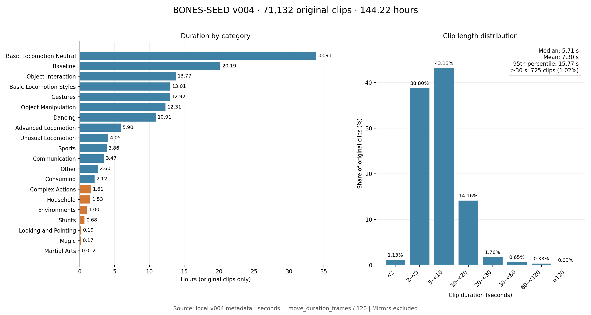

# BONES-SEED v004 動作統計

分析日期：2026-10-09（台北）。來源：`/home/imlab/Desktop/Bill/bones-seed/metadata/seed_metadata_v004.parquet`。SHA-256：`7cbe5624f91ae19af3feee69cff74b2cf553fb26367c8edc4b674c3d8ea97e7d`。

## 計算口徑

- 以 metadata 每一列為一段完整動作，秒數 = `move_duration_frames / 120`。120 fps 依本機 README 的 Metadata Schema。
- 原始動作依 `is_mirror == False` 篩選。三種骨架表示、同段多條文字描述不重複計數。
- package 與 category 為兩種分組，各自覆蓋全資料，兩表不可相加。
- 這是完整片段的分類與長度，未拆分 temporal labels；不等同逐秒細動作時長。
- 原始段數不等同互不相似的動作種類或獨立拍攝 session；同一內容可由多位演員、不同 take 重複。
- 本次直接統計 metadata，未讀取所有 BVH／G1 內容驗證實際幀數。

## 總量

| 資料 | 段數 | 小時 |
|---|---:|---:|
| 全部 | 142,220 | 288.320845 |
| 原始 | 71,132 | 144.215743 |
| Mirror | 71,088 | 144.105102 |

44 段原始動作沒有 Mirror；全部 Mirror 皆能以名稱移除 `_M` 配對原始動作。
7,653 對的 metadata 幀數相差 1 幀（7,645 對 Mirror 少 1 幀、8 對多 1 幀），因此總時長應逐筆加總，不能直接除以二。
原始資料共 522 位表演者、3,813 個不同 `content_name`；後者是命名欄位數量，不能視為語意去重後的動作類型數。

## 8 大分類

| Package | 含 Mirror 段數 | 含 Mirror 小時 | 原始段數 | 原始小時 | 表演者 | content_name 數 |
|---|---:|---:|---:|---:|---:|---:|
| Locomotion | 74,488 | 150.506 | 37,260 | 75.294 | 513 | 790 |
| Communication | 21,493 | 33.146 | 10,749 | 16.577 | 214 | 276 |
| Interactions | 14,643 | 30.933 | 7,322 | 15.468 | 154 | 1,492 |
| Dances | 11,006 | 21.818 | 5,503 | 10.909 | 82 | 518 |
| Gaming | 8,700 | 21.640 | 4,351 | 10.824 | 188 | 252 |
| Everyday | 5,816 | 17.343 | 2,908 | 8.671 | 131 | 385 |
| Sport | 3,993 | 7.734 | 1,998 | 3.871 | 111 | 82 |
| Other | 2,081 | 5.202 | 1,041 | 2.602 | 128 | 18 |

## 20 個細分類

| Category | 含 Mirror 段數 | 含 Mirror 小時 | 原始段數 | 原始小時 | 表演者 | content_name 數 |
|---|---:|---:|---:|---:|---:|---:|
| Basic Locomotion Neutral | 33,430 | 67.748 | 16,729 | 33.908 | 252 | 309 |
| Baseline | 22,878 | 40.379 | 11,440 | 20.192 | 479 | 13 |
| Object Interaction | 10,817 | 27.529 | 5,410 | 13.769 | 217 | 523 |
| Basic Locomotion Styles | 10,746 | 26.013 | 5,373 | 13.008 | 103 | 157 |
| Gestures | 17,590 | 25.842 | 8,797 | 12.924 | 202 | 228 |
| Object Manipulation | 11,620 | 24.618 | 5,810 | 12.310 | 114 | 1,256 |
| Dancing | 11,006 | 21.818 | 5,503 | 10.909 | 82 | 518 |
| Advanced Locomotion | 6,036 | 11.786 | 3,019 | 5.895 | 149 | 167 |
| Unusual Locomotion | 3,242 | 8.100 | 1,621 | 4.050 | 33 | 202 |
| Sports | 3,973 | 7.710 | 1,988 | 3.858 | 110 | 74 |
| Communication | 3,723 | 6.933 | 1,862 | 3.468 | 125 | 32 |
| Other | 2,081 | 5.202 | 1,041 | 2.602 | 128 | 18 |
| Consuming | 1,388 | 4.244 | 694 | 2.122 | 104 | 74 |
| Complex Actions | 540 | 3.224 | 270 | 1.612 | 23 | 65 |
| Household | 1,318 | 3.069 | 659 | 1.535 | 14 | 24 |
| Environments | 614 | 2.004 | 307 | 1.002 | 14 | 44 |
| Stunts | 858 | 1.356 | 429 | 0.678 | 34 | 79 |
| Looking and Pointing | 180 | 0.371 | 90 | 0.186 | 21 | 16 |
| Magic | 160 | 0.350 | 80 | 0.175 | 25 | 6 |
| Martial Arts | 20 | 0.024 | 10 | 0.012 | 2 | 8 |

## 稀缺類型與補充方向

以下為本資料內部的相對稀缺判讀，不是通用最低資料量標準；是否補充取決於模型任務。

- Martial Arts：10 段、43.64 秒、2 位表演者，若需武術能力應優先補充。
- Looking and Pointing：90 段、11.14 分鐘、21 位表演者。Magic：80 段、10.50 分鐘、25 位表演者；Magic 主要適用需要幻想／遊戲動作的任務。
- Stunts：429 段、40.69 分鐘、34 位表演者；需要特技能力時補充。
- 日常／機器人任務可優先考慮 Household（659 段、1.535 小時、14 人）、Environments（307 段、1.002 小時、14 人）、Complex Actions（270 段、1.612 小時、23 人），增加演員、物件／場景和動作串接的變化。
- Locomotion package 佔原始總時長 52.21%。Baseline 雖有 20.192 小時、11,440 段，但只有 13 個 `content_name`，時長多不代表內容種類多。分類沿用原始 metadata。
- Mirror 不會增加表演者與原始拍攝多樣性；補資料時應以未鏡像片段與多樣性評估。

## 原始動作長度

平均 7.299 秒、中位數 5.708 秒；中間 50% 位於 4.000–8.358 秒。
90／95／99 百分位為 12.617／15.767／30.217 秒；範圍 0.575–180.142 秒。

| 秒數區間（左含右不含） | 原始段數 | 段數占比 | 原始小時 | 時長占比 |
|---|---:|---:|---:|---:|
| <2 | 804 | 1.130% | 0.398 | 0.276% |
| 2–<5 | 27,600 | 38.801% | 28.090 | 19.478% |
| 5–<10 | 30,681 | 43.132% | 58.956 | 40.880% |
| 10–<20 | 10,073 | 14.161% | 36.837 | 25.543% |
| 20–<30 | 1,249 | 1.756% | 8.461 | 5.867% |
| 30–<60 | 463 | 0.651% | 5.061 | 3.509% |
| 60–<120 | 238 | 0.335% | 5.492 | 3.808% |
| ≥120 | 24 | 0.034% | 0.921 | 0.639% |

83.06% 的片段短於 10 秒。30 秒以上只有 725 段（1.02%），其中 60 秒以上 262 段，120 秒以上 24 段。
若目標是長時間連續動作，建議增加自然連續錄製的長片段及動作轉換；以反覆拼接短片段不等同新增長動作資料。

## 重現

執行 `python analysis/bones-seed/analyze.py`，可重建本報告、CSV、JSON 與 PNG／SVG 圖表。
